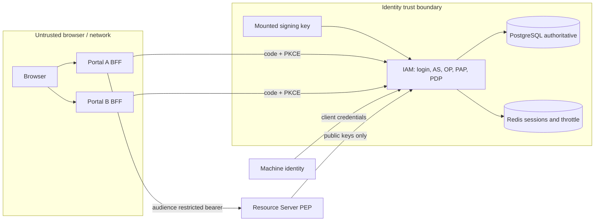

# Architecture and requirements

The baseline is option A: a modular application owns identity, authentication, OAuth/OIDC, client registry and policy
decisions. Separate resource servers enforce tokens and scopes; the web client is a server-side OAuth client/BFF. Split
PDP evaluation from the identity control plane only after measuring a workload that needs independent scaling. Option B
adds network latency and operational boundaries; option C offers better endpoint isolation at materially greater
deployment and consistency cost.

AuthN proves identity. AuthZ grants an action on a resource. The IdP authenticates; AS issues OAuth tokens; OP adds OIDC
identity. RS validates tokens and enforces access. PDP evaluates policy, PEP enforces it, PAP administers policy and PIP
supplies authoritative attributes. In this baseline the SQL-backed decision endpoint is PDP, management endpoints are
PAP, PostgreSQL is PIP, and resource endpoint scope enforcement is PEP. The sample orders endpoint does not yet call the
resource-level PDP.

## Security invariants

1. Framework handlers own OAuth parsing, client authentication, code binding, revocation and metadata.
2. Subject comes from the validated token, never decision-request JSON.
3. Membership, resource tenant and permissions come from the directory; all must match.
4. Unknown users, inactive users and failed dependencies cannot issue user tokens.
5. Refresh processing and lifecycle writes are fenced by principal locks, snapshot versions and tombstones at the
   authoritative PostgreSQL primary.
6. JWT revocation is bounded by lifetime at offline resource servers; no immediate global invalidation is promised.
7. Signing secrets and MFA decryption material are external inputs; no reusable secret enters source control.

Target SLOs are 99.99% availability, regional token p99 <100ms and supported cached PDP p99 <10ms. They are goals, not
measurements. Current acceptance is a runnable Java 21 build and passing documented tests; the complete requested
enterprise acceptance list remains open in status.md.

Shared issuer is selected. Tenants are directory/policy boundaries, not issuer boundaries. A tenant claim is never a
substitute for a resource lookup. Separate issuers improve customer key/policy isolation but multiply configuration and
operational cost. Dedicated deployments are appropriate for custody and residency requirements.

Multi-AZ single-primary PostgreSQL is the intended initial consistency domain. Active-passive regional recovery requires
fencing and reconciliation of token families before writes resume. Asynchronous replication cannot guarantee replay-free
active-active refresh. A future active-active design must assign each family an authoritative region or use globally
consistent transactional storage.
