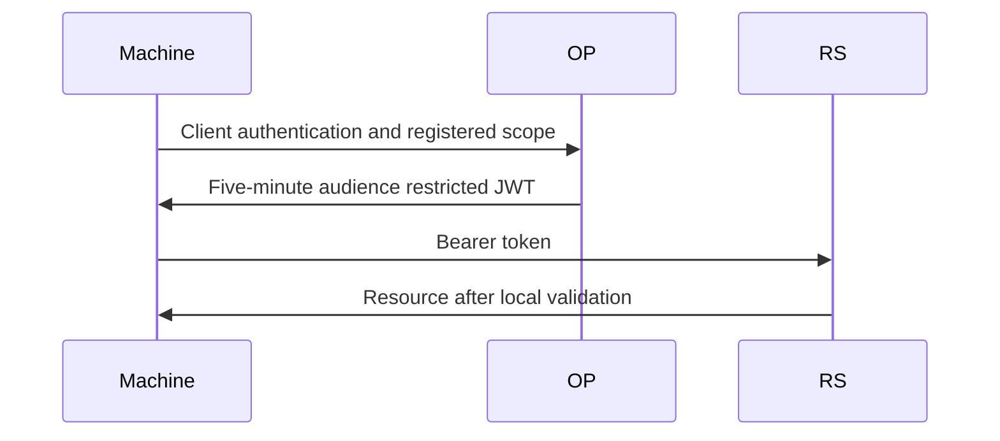
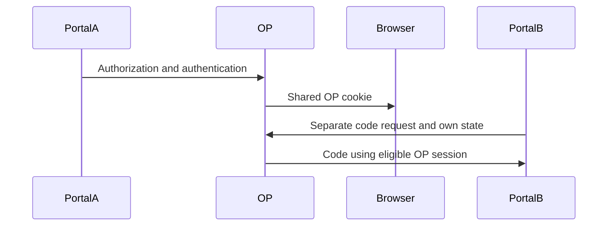
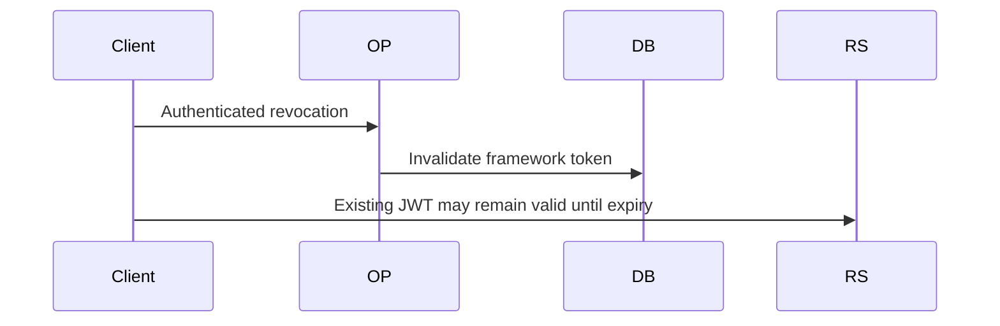
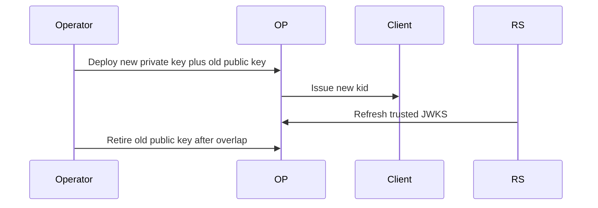
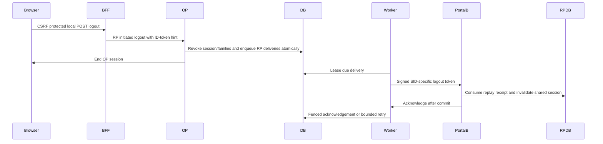
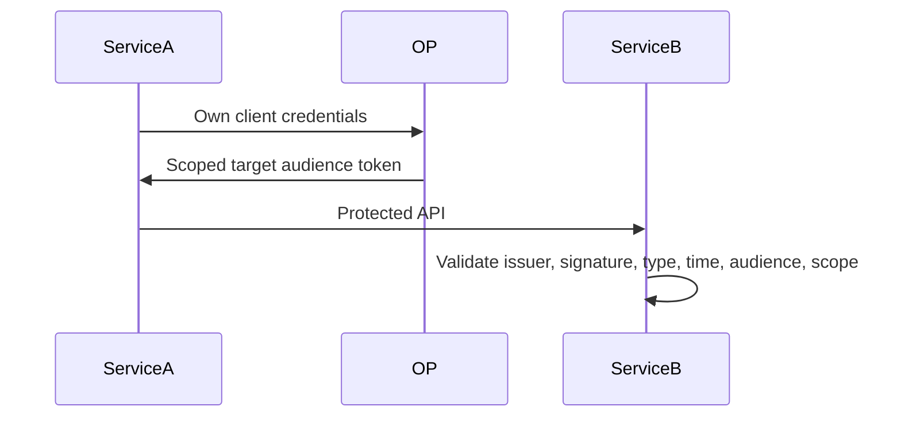

# Authentication, token and authorization sequences

Diagrams labelled design are not implemented capabilities. OP/DB are inside the identity boundary; browsers, clients and
peer services are outside it. TLS is mandatory outside local development.

## Browser and confidential web PKCE

```mermaid
sequenceDiagram
    Browser->>BFF: Start login; BFF stores state and nonce
    BFF->>OP: Authorize with S256 challenge
    OP->>Browser: Authenticate and enforce enrolled MFA
    OP->>BFF: Single-use code and state
    BFF->>OP: Code, client authentication, verifier
    OP->>BFF: ID token, access token, refresh token
    BFF->>RS: Audience/scope restricted access token
```

## Mobile PKCE design (not implemented)

```mermaid
sequenceDiagram
    App->>OP: System browser, S256 and app link
    OP->>App: Single-use code
    App->>OP: Code and verifier; no embedded client secret
```

## Client Credentials



## SSO



## MFA

```mermaid
sequenceDiagram
    User->>OP: Password login
    OP->>User: TOTP challenge when enrolled
    User->>OP: OTP
    OP->>DB: Lock credential, verify and consume step
    OP->>User: Rotate session ID; continue authorization
```

## Refresh

```mermaid
sequenceDiagram
    Client->>OP: Authenticated refresh R1
    OP->>DB: Lock family and load authorization
    OP->>DB: Persist R2 and digest history
    OP->>Client: R2; discard R1
```

## Refresh replay

```mermaid
sequenceDiagram
    Client->>OP: Reuse R1 after R2 exists
    OP->>DB: Lock family; identify old generation
    OP->>DB: Delete authorization and audit replay
    OP->>Client: invalid_grant; reauthenticate
```

## Revocation



## JWKS rotation design (not automated)



## Central authorization

```mermaid
sequenceDiagram
    PEP->>PDP: Authenticated subject; action/resource selectors
    PDP->>DB: Fresh membership, resource tenant, role permissions
    PDP->>PEP: ALLOW or DENY
    PEP->>Business: Enforce decision; integration outstanding
```

## Federation design (not implemented)

```mermaid
sequenceDiagram
    OP->>EnterpriseIdP: OIDC redirect with state/nonce
    EnterpriseIdP->>OP: Validated assertion
    OP->>Directory: Map issuer + subject; explicit linking
    OP->>Client: Local code flow
```

## Logout



Delivery is asynchronous. Unregistered RPs and terminal failures can retain local sessions; existing offline JWTs retain
their own expiration. See [delivery, replay and retention guarantees](backchannel-logout.md).

## Service to service



## Authenticator management

Open `/mfa/settings` on the identity provider (or use Account & security in the console).
A password-confirmed enrollment returns a private setup key once. Enter it manually in a TOTP
app (SHA1, six digits, 30 seconds), then submit a fresh code within ten minutes. Setup is bound
to the initiating IAM session. Confirmation enables MFA, revokes existing sessions/grants, and
shows ten recovery codes once. Store those codes outside the browser. A new login must complete
`/mfa` before authorization proceeds. Password recovery does not remove this requirement.

From the same settings page, renewing recovery codes or removing MFA requires the current
password plus a new TOTP or unused recovery code. Renewal invalidates every previous recovery
code; both operations revoke all sessions and grants. Recovery codes are stored as digests and
consumed transactionally. Never send setup keys or recovery codes to application frontends.

`MFA_REQUIRED=true` (default false) requires enrollment before authorization for all users.
It also forbids MFA removal. `MFA_REMOVAL_ALLOWED=false` independently disables self-service
removal. These are deployment-wide policies, not organization-specific policy rules. Management
requires a fresh factor proof even when the session previously completed MFA. Existing Redis
request throttles, durable verification lockout, principal locks, and audit events remain active.
No SMS/email OTP fallback is implemented.
